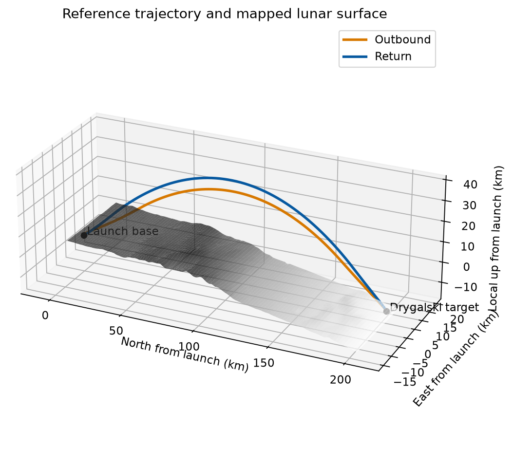
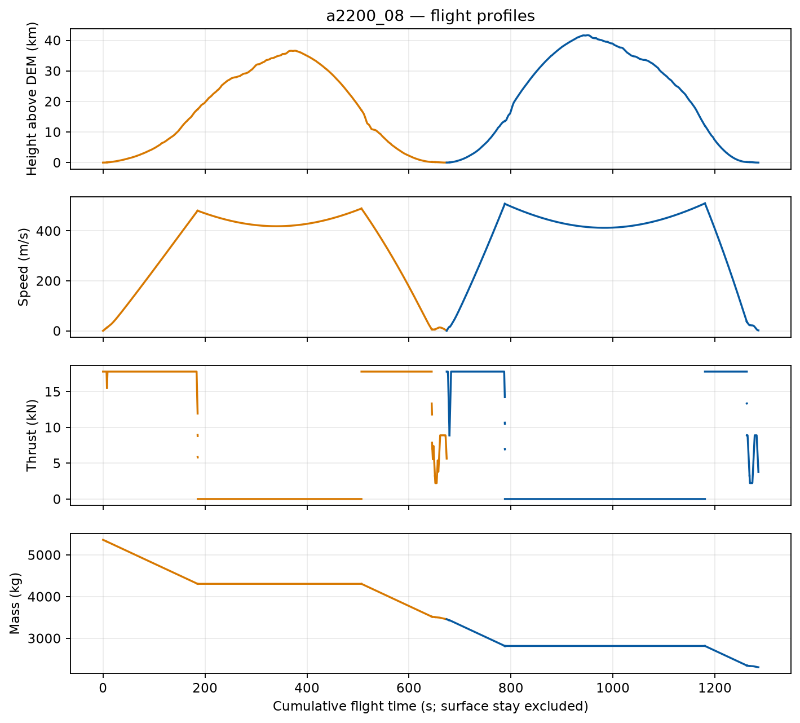

# Hopper1 simulation code

Hopper1 is a lunar hopper studied in the EAS4700 senior design course. The vehicle lifts off from a launch base near the lunar south pole, flies a ballistic hop of about 202 km to the floor of Drygalski crater, lands, and flies back to the launch base. This repository holds the simulation code for that mission. It has three parts:

- **Astro** is the astrodynamics trajectory optimizer. It finds the smallest wet mass (dry mass plus propellant) that lets the vehicle fly the round trip over real lunar terrain, and it checks the resulting reference flight independently.
- **GN** is the guidance and navigation (G&N) simulation. It takes the reference flight from Astro, simulates the navigation sensors (an inertial measurement unit, two star trackers and terrain-relative navigation position fixes) with their errors, and runs a Kalman filter over many random trials to estimate how well the vehicle knows its position at touchdown.
- **Animation** renders videos of the saved reference flight.

The selected design is called 8-A2200: eight A2200 engines and a 2,000 kg dry mass.



*Outbound (orange) and return (blue) reference trajectory of the selected 8-A2200 design over the mapped lunar surface, from the launch base to the Drygalski target, about 202 km away.*



*Height above the terrain model, speed, thrust and vehicle mass against cumulative flight time for the outbound (orange) and return (blue) hops of the same flight. Time spent on the surface between the hops is excluded.*

## Repository layout

| Path | What it is |
|---|---|
| `Astro/` | Trajectory optimizer, mission configuration, lunar terrain data, scripts and tests. See [Astro/README.md](Astro/README.md). |
| `GN/` | Navigation simulation (`gn_sim` package), launcher scripts, settings and tests. See [GN/README.md](GN/README.md). |
| `Animation/` | Two scripts that render videos of the saved flight. See [Animation/README.md](Animation/README.md). |
| `docs/images/` | The two figures shown above. |
| `AGENTS.md` | Working rules for the project: which folder each part owns and what may be edited or published. |
| `pytest.ini` | Test configuration. It lists `Astro/tests` and `GN/tests` and adds `Astro` and `GN` to the Python import path. |
| `requirements.txt` | Pinned Python package versions (Python 3.14). |
| `.gitattributes` | Disables line-ending conversion. See the warning below. |
| `.gitignore` | Keeps generated results, caches and virtual environments out of Git. |

The three parts are kept separate on purpose. GN reads Astro's saved flight and imports Astro's `hopper` and `mission` packages read-only. Astro and the Animation scripts never import GN code, and GN never changes anything under `Astro/`.

## What is and is not stored

Stored in this repository:

- Source code, configuration files (`Astro/mission.yaml`, `Astro/config.yaml`, `GN/nav_config.yaml`) and Markdown documentation for all three parts.
- `Astro/data/`: the lunar terrain inputs, which are public NASA LOLA (Lunar Orbiter Laser Altimeter) data: a 30 m resolution corridor elevation model, a coarser global elevation grid and source metadata. `Astro/data/terrain_source.json` gives the source and citation.
- `Astro/results/a2200_08/` and `Astro/results/a2200_12/`: only `sizing.npz` and `duals.npz`, the optimizer restart arrays of the two accepted cases. The optimizer has no cold start for these cases, so the arrays are required to regenerate the results.
- `docs/images/`: the two figures above.

Not stored: reports, plots, validation files, saved trajectories, GN outputs and animation videos. All of these are generated locally by the commands below and are excluded by `.gitignore`. Where the documentation names a file under a `results/` folder, that file appears only after the corresponding script has been run.

## Setup

Windows / PowerShell, Python 3.14, from the repository root:

```powershell
py -3.14 -m venv .venv
.\.venv\Scripts\python.exe -m pip install -r requirements.txt
```

All commands in this repository are run from the repository root with `.\.venv\Scripts\python.exe -B ...`. The `-B` flag stops Python from writing bytecode caches.

## Regenerating the results

**All commands in this repository are run from the repository root.** Every output folder named below is created locally by the script and is not stored.

```powershell
# 1. Validate the saved flights and write their reports, plots and summaries
.\.venv\Scripts\python.exe -B Astro/scripts/run_case.py a2200_08
.\.venv\Scripts\python.exe -B Astro/scripts/run_case.py a2200_12

# 2. Navigation study on the 8-A2200 flight (needs step 1 for a2200_08)
.\.venv\Scripts\python.exe -B GN/scripts/run_nav.py

# 3. Tests (some need the outputs of step 1)
.\.venv\Scripts\python.exe -B -m pytest -q -p no:cacheprovider
```

Expected wet mass: 8 A2200 5,363.13 kg, 12 A2200 5,128.67 kg. The other cases and studies described in [Astro/README.md](Astro/README.md) (10 and 14 A2200, mixed engines, hop distance, design checks) were produced by continuation from earlier solutions that are not stored here; their numbers are recorded in that guide.

### What can I run from a fresh clone?

A fresh clone holds the code, the terrain data and the restart arrays of `a2200_08` and `a2200_12` only, so almost everything starts with step 1 (`run_case.py a2200_08`). "Step 1" below means that command.

| Step | Command | Needs | Writes to | Details |
|---|---|---|---|---|
| 1 | `.\.venv\Scripts\python.exe -B Astro/scripts/run_case.py a2200_08` (and `a2200_12`) | Stored restart arrays only | `Astro/results/<case>/` | [Astro cases](Astro/README.md#cases-defined-in-missionyaml) |
| not possible | `run_case.py a2200_10`, `a2200_14`, `ar46_leros_rcs` | Restart arrays that are not stored | None (it stops with "Sizing restart missing") | [Astro cases](Astro/README.md#cases-defined-in-missionyaml) |
| any time | `.\.venv\Scripts\python.exe -B Astro/scripts/run_tracker_sun_sweep.py` | Stored `a2200_08` array only | `Astro/results/tracker_sun_sweep/a2200_08/` | [Astro studies](Astro/README.md#studies-and-supporting-scripts) |
| any time | `.\.venv\Scripts\python.exe -B Astro/scripts/run_descent_variant.py TAG --seed a2200_08 ...` and `descent_ladder.py a2200_12` | Stored arrays as seeds | `Astro/results/TAG/`, `Astro/results/ladder_<case>/` | [Astro studies](Astro/README.md#studies-and-supporting-scripts) |
| after step 1 | `Astro/scripts/run_los.py`, `run_earth_los.py`, `run_dv_losses.py`, `reconstruct_tracker_mounts.py` | Step 1 outputs | `Astro/results/los/`, `earth_los/`, `<case>/dv_losses.json`, `mount_reconstruction/a2200_08/` | [Astro studies](Astro/README.md#studies-and-supporting-scripts) |
| partly | `Astro/scripts/run_hop_distance.py`, `run_design_checks.py` | The solves need no step 1 output; the final report step does (design checks also need a file that is never written from the stored arrays) | `Astro/results/hop_distance/`, `Astro/results/design_checks/` | [Astro studies](Astro/README.md#studies-and-supporting-scripts) |
| after step 1 | `.\.venv\Scripts\python.exe -B GN/scripts/run_nav.py`, then `run_trn_sweep.py`, `run_design_checks.py` | Step 1 for `a2200_08`; `GN/scripts/run_design_checks.py` also needs the output folder, so run `run_nav.py` or `run_trn_sweep.py` before it | `GN/results/dem_a2200_08/` | [GN](GN/README.md#running-it) |
| after step 1 | `.\.venv\Scripts\python.exe -B Animation/animate_hop.py` and `animate_phases.py` (both take `--preview`) | Step 1 for `a2200_08` | `Animation/results/a2200_08/`, `Animation/results/a2200_08_phases/` | [Animation](Animation/README.md) |
| after step 1 | `.\.venv\Scripts\python.exe -B -m pytest -q -p no:cacheprovider` | Step 1 for the tests that read its outputs | Nothing | [Astro tests](Astro/README.md#tests), [GN tests](GN/README.md#tests) |
## Do not change line endings or pinned files

A saved flight records SHA-256 hashes (cryptographic fingerprints of file contents) of `Astro/mission.yaml`, `Astro/config.yaml`, every Python file in `Astro/mission/` and `Astro/hopper/`, and the terrain files in `Astro/data/`. The trajectory cache identity also covers `Astro/scripts/run_roundtrip.py`. GN refuses a flight whose hashes no longer match. `.gitattributes` therefore disables line-ending conversion; keep it that way, and re-run `run_case` after any edit to those files.

## Where to read next

| If you want to | Read |
|---|---|
| Understand or rerun the trajectory optimizer, its assumptions and its recorded results | [Astro/README.md](Astro/README.md) |
| Understand or rerun the navigation study | [GN/README.md](GN/README.md) |
| Render the flight animations | [Animation/README.md](Animation/README.md) |
| Know the rules for editing or publishing | `AGENTS.md` |
